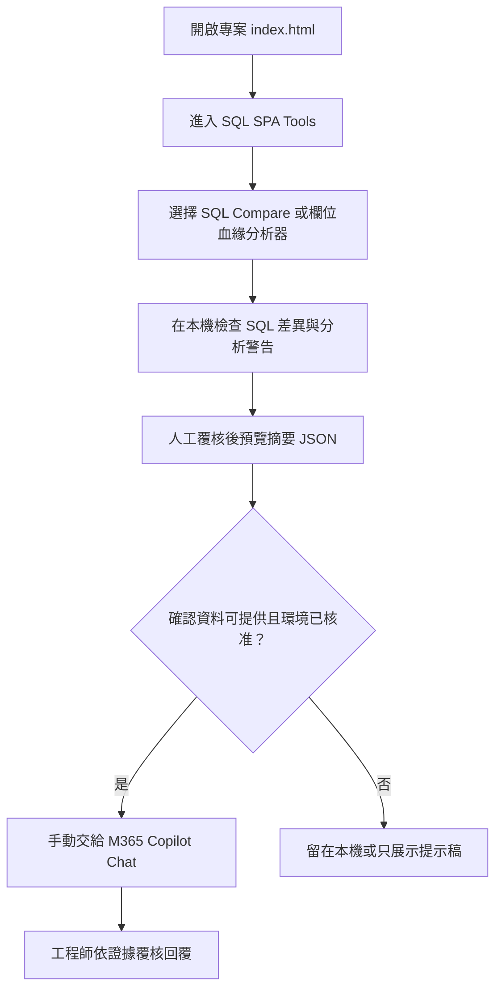
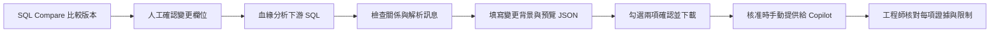

# SQL 變更影響評估 Copilot｜使用者操作手冊

本專案提供一套 SQL 變更影響評估展示流程：先在瀏覽器本機使用 SQL SPA Tools 比較 SQL、檢視欄位血緣，再由操作者檢查並匯出摘要 JSON，視核准情況手動交給 Microsoft 365 Copilot Chat 整理影響說明。它是黑客松參賽原型，並未直接連接資料庫或整合 M365 API；分析結果和 Copilot 回覆都需要工程師覆核。

## 目錄

- [快速開始](#快速開始)
- [整體使用流程](#整體使用流程)
- [SQL 變更影響 Demo](#sql-變更影響-demo)
- [解析警告案例](#解析警告案例)
- [Colab 自動化測試](#colab-自動化測試)
- [資料安全與保存](#資料安全與保存)
- [常見問題](#常見問題)
- [專案文件與維護](#專案文件與維護)

## 快速開始

1. 保留專案資料夾的完整結構，不要單獨移動入口 HTML 或工具頁。
2. 使用 Chrome 或 Edge 開啟根目錄的 [`index.html`](index.html)。
3. 按「進入 SQL SPA Tools」，從平台入口選擇 SQL Compare、欄位血緣分析器或其他工具。
4. 第一次展示請使用內附的合成案例，不要載入生產 SQL 或客戶資料。

一般 SQL 工具可直接在瀏覽器開啟，不需先安裝 Node.js、Python 或資料庫。瀏覽器若詢問檔案或資料夾權限，只授權給本次需要處理的資料。SQL SPA Tools 各項工具的完整操作步驟見[工具使用手冊](sql-spa-tools-main/README.md)。

## 整體使用流程

## SQL 變更影響 Demo

固定案例使用合成資料，位於 [`sql-spa-tools-main/uat-fixtures/copilot-impact-demo/`](sql-spa-tools-main/uat-fixtures/copilot-impact-demo/)：

- `customer-before.sql`：變更前的合成 SQL。
- `customer-after.sql`：變更後的合成 SQL。
- `downstream.sql`：示範下游欄位關係。
- `expected.json`：預期影響清單，供人工比對。

### 比較變更前後 SQL

1. 在工具入口開啟「SQL Compare」。
2. 將 `customer-before.sql` 載入「舊版 SQL」，將 `customer-after.sql` 載入「新版 SQL」。也可以直接貼上檔案內容。
3. 按「比對」，先看逐行差異，再切換到「結構差異摘要」。
4. 記下經人工確認的變更物件、欄位與前後型別。此摘要供後續填入；Copilot 匯出工具不會替你驗證 SQL 差異。

### 分析欄位血緣

1. 開啟「SQL 欄位血緣分析器」，載入 `downstream.sql`，按「分析」。
2. 檢查「欄位對照表」中的來源欄位、目標欄位及直接／間接關係。
3. 查看「語句與訊息」中的警告或錯誤。若有解析警告，先判斷分析範圍是否不足；不要把未找到關係解讀成沒有影響。
4. 可在「上下游追溯樹」輸入欄位或 `物件.欄位`，再選擇上游、下游或雙向追溯。

### 檢查並匯出 Copilot 摘要

1. 在欄位血緣分析器的「欄位對照表」按「Copilot 摘要」。
2. 依 SQL Compare 的人工檢查結果填入完整變更背景。固定案例為：

   - 變更物件：`DEMO_CUSTOMER`
   - 變更欄位：`CUSTOMER_SEGMENT`
   - 變更前型別：`VARCHAR2(20)`
   - 變更後型別：`VARCHAR2(40)`

3. 閱讀 JSON 預覽，確認影響清單及名稱符合本次案例。填入變更背景後，摘要只保留來源物件和欄位符合該背景的關係。
4. 勾選「已依 SQL Compare 人工核對」及「已檢查名稱與資料內容」兩項確認，再按「下載 JSON」。匯出資料會標記變更背景為操作者輸入、未由工具驗證。
5. 若使用環境已核准且檔案內容確認不含機敏資料，可將 JSON 手動交給 M365 Copilot Chat，並使用[固定提示](參賽準備/Copilot%20Chat%20固定提示.md)。最後逐項核對 Copilot 回覆與 JSON 證據。

摘要不包含原始 SQL、路徑、運算式或解析訊息全文，但會包含物件與欄位名稱，以及警告／錯誤數量。下載與上傳前請重新檢查檔案。Copilot 不會執行 SQL、修改檔案、核准變更或觸發部署。

## 解析警告案例

[`parser-warning.sql`](sql-spa-tools-main/uat-fixtures/copilot-impact-demo/parser-warning.sql) 是刻意包含解析警告的合成案例，可用來確認操作流程會保留不確定性：

1. 在欄位血緣分析器載入該檔並按「分析」。
2. 開啟「語句與訊息」，確認警告內容；再開啟 Copilot 摘要預覽，查看警告數量及限制是否出現在 JSON。
3. 交給 Copilot 的提示要求明確說明警告及分析範圍，不得宣稱影響清單完整。

提示詞只是輸出指引，不保證 Copilot 一定遵循。銀行核准租用戶及附件上傳流程尚未完成驗收；未獲核准時，只展示本機結果與提示稿，不要改用個人帳戶處理銀行資料。Demo 講稿及目前驗收界線見[3 至 5 分鐘 Demo 講稿](參賽準備/3至5分鐘Demo講稿.md)。

## Colab 自動化測試

Colab 測試框架供維護者檢查 SQL SPA Tools，不是一般 Demo 的必要步驟。

1. 將 [`colab/sql_tools_test_framework.ipynb`](colab/sql_tools_test_framework.ipynb) 開啟於 Google Colab。
2. 選擇「執行階段 → 全部執行」。
3. 選擇上傳完整專案 ZIP 時，解壓後的根目錄必須同時有 `sql-spa-tools-main/` 和 `colab/`；也可依 Notebook 設定改用可讀取的 Git URL。
4. `MODE = 'quick'` 用於快速檢查，產生 50 組案例；`MODE = 'full'` 產生 1,000 組案例並執行較完整的瀏覽器及效能檢查。
5. 執行完成後下載 `test-results.zip`。報告亦暫存在 Colab 工作階段的 `colab/outputs/`；離開或重設工作階段前請先下載。

目前納入版本控制的測試成果副本位於 [`test-results/`](test-results/)；內容包括 Excel 測試報告、PNG／SVG 圖表、合成案例 fixtures，以及 JSON／CSV 結果。這是一次完整模式執行的快照，不會隨每次 Colab 執行自動更新。若要更新版本庫中的成果，請將新下載的 `test-results.zip` 解壓並用新結果取代此資料夾，再提交變更。

詳細設定、結果解讀與本機維護命令見[Colab 測試操作指南](colab/docs/testing-guide.md)。雲端執行環境及效能數值會變動；請連同報告中的環境資訊解讀，不要把單次結果當成跨環境比較或正式效益結論。

### 關閉 Colab 工作階段

Windows 使用者可雙擊 [`colab/close_colab_sessions.bat`](colab/close_colab_sessions.bat)。程式會列出工作階段、要求確認，關閉請求送出後再向伺服器確認是否全部關閉。需先安裝並登入 Google Colab CLI；安裝與認證方式見[Colab CLI 設定說明](colab/docs/setup.md)。

## 資料安全與保存

- SQL Compare 與欄位血緣分析主要在瀏覽器本機處理，原始 SQL 不會由這條展示流程自動送到 Copilot。
- 只有操作者檢查並下載摘要後，才會有手動交接至 Copilot Chat 的步驟；上傳時仍須遵循租用戶、資料分類與銀行規定。
- 摘要可能含資料表及欄位名稱。名稱、JSON 檔案與 Copilot 回覆都應依其資料敏感度處理；不能因摘要不含原始 SQL 就視為可公開。
- Demo fixtures 使用合成 SQL 和示範名稱。不要替換成客戶資料、帳號、身分證字號、生產 SQL 或未核准的內部物件名稱。
- 分析僅涵蓋目前載入且可靜態解析的 SQL。未載入物件、動態 SQL、執行期行為及外部排程／報表可能不在範圍內；空的影響清單不代表全系統沒有影響。
- Formatter 寫回與個資清除器可能修改選取的本機檔案。操作前先檢查目標並保留備份；其他工具的資料保存方式和限制見[SQL SPA Tools 使用手冊](sql-spa-tools-main/README.md)。

## 常見問題

### 開啟入口後樣式或工具頁失效

確認專案資料夾結構完整，並使用 Chrome 或 Edge 開啟根目錄 `index.html`。不要只複製入口頁或單一工具 HTML，因為頁面需要同目錄的 CSS、JavaScript 及其他檔案。

### 瀏覽器無法讀取或寫回資料夾

重新選取正確資料夾並授予瀏覽器所要求的權限。若功能有唯讀模式或 ZIP 匯出選項，可使用該方式保存結果；寫入前仍應檢查檔案內容。

### Copilot 摘要的下載按鈕無法使用

若有填寫任何變更欄位，物件、欄位及前後型別都必須完整且格式有效；另需勾選變更人工核對與資料內容檢查兩項確認。請以 SQL Compare 結果核對背景，因為匯出工具不會比對兩版 SQL。

### Colab 找不到 `runner.py`

請使用包含 `sql-spa-tools-main/` 與 `colab/` 的完整專案 ZIP，不能只上傳 SQL SPA Tools 子資料夾。確認 ZIP 結構後，重新上傳並從 Notebook 安裝步驟開始執行。其他 Colab 問題見[測試操作指南](colab/docs/testing-guide.md)。

### Colab 報告圖表中文字缺字或無法產生

請使用最新版完整專案 ZIP，重新執行 Notebook 的套件、字型安裝與字型快取更新步驟，再執行測試。若仍失敗，保留錯誤訊息及 `test-results.zip`（若有產生）供維護者檢查。

### 輸入欄位後沒有下游影響

先查看分析訊息與欄位對照表，確認 SQL 已載入且來源物件／欄位名稱與人工輸入完全對應。解析警告、缺少上游 SQL 或靜態分析範圍不足時，回到 SQL SPA Tools 補查；不要將空清單描述成「沒有影響」。

## 專案文件與維護

| 資料夾／檔案 | 用途 |
| --- | --- |
| [`index.html`](index.html) | 本專案的展示入口。 |
| [`sql-spa-tools-main/`](sql-spa-tools-main/) | SQL 工具、逐工具使用手冊、測試與 CI。 |
| [`參賽準備/`](參賽準備/) | 提案、固定提示、Demo 講稿及成效驗證計畫。 |
| [`colab/`](colab/) | Google Colab 自動化測試、結果與 CLI 輔助工具。 |
| [`theme.md`](theme.md) | 鎖頭銀行企業配色與 Office 素材使用原則。 |

- [SQL SPA Tools 逐工具操作與維護手冊](sql-spa-tools-main/README.md)
- [黑客松提案報告](參賽準備/黑客松提案報告.md)
- [Copilot 原型設計](參賽準備/sql-spa-tools-copilot-hackathon-design.md)
- [成效驗證計畫與紀錄](參賽準備/成效驗證計畫與紀錄.md)
- [參賽待辦](參賽準備/TODO.md)
- [正式提案書](參賽準備/參賽文件/SQL_SPA_Tools_黑客松正式提案書.docx)
- [競賽簡報](參賽準備/參賽文件/SQL_SPA_Tools_競賽簡報.pptx)
- [成效量化報告](參賽準備/參賽文件/SQL_SPA_Tools_成效量化報告.xlsx)

維護者應依 [`sql-spa-tools-main/AGENTS.md`](sql-spa-tools-main/AGENTS.md) 執行該子專案的回歸驗證。Colab 測試框架的依賴與本機命令列於[測試操作指南](colab/docs/testing-guide.md)。新增或修改 Office 文件及簡報素材時，先遵循 [`theme.md`](theme.md)；不要把尚未驗證的個人帳戶探索或單次測試結果描述為銀行環境驗收或實測效益。
