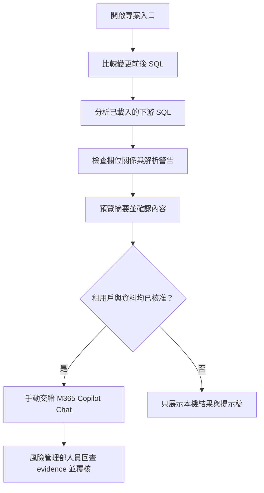
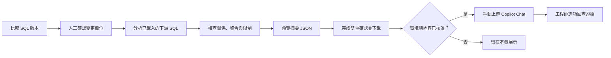

# SQL SPA Tools 黑客松作品使用手冊

本作品以 SQL SPA Tools 搭配 Microsoft 365 Copilot Chat，協助風險管理人員檢視風險分群與管理報表相關的 SQL 變更。SQL 比對和欄位血緣分析在使用者瀏覽器中進行；操作者檢查摘要並明確確認後，才可下載 JSON，並在核准的 M365 環境中手動交給 Copilot Chat 整理。Copilot 提供閱讀與整理協助，影響判斷、證據覆核和變更核准仍由具權責人員負責。

這是黑客松參賽原型。它不連接銀行資料庫、不呼叫 Copilot API，也不會執行 SQL、修改資料庫或核准變更。展示和測試請使用專案提供的合成資料。

參賽期間：2026 年 10 月 22 日至 12 月 24 日

參賽人員：鎖頭銀行風險管理部 Dunk

作品型態：瀏覽器本機 SQL 分析工具＋Microsoft 365 Copilot Chat 人工交接流程

提案範圍：以風險分群與報表 SQL 變更的影響覆核為展示主線

提案摘要  本案面向風險管理人員檢視風險分群及報表 SQL 變更的情境，以 SQL Compare 與欄位血緣整理來源、下游影響及證據，再由 M365 Copilot Chat 協助撰寫摘要與覆核清單。全程使用合成資料、使用者確認與人工覆核；不連接銀行資料庫、不代替風險判斷，也不代表變更核准。

## 目錄

- [快速開始](#快速開始)
- [作品範圍與角色](#作品範圍與角色)
- [風險管理 SQL 變更 Demo](#風險管理-sql-變更-demo)
- [解析警告與結果不完整時](#解析警告與結果不完整時)
- [質化效益與量化情境](#質化效益與量化情境)
- [目前驗證證據與限制](#目前驗證證據與限制)
- [資料安全與保存](#資料安全與保存)
- [常見問題](#常見問題)
- [專案文件](#專案文件)
- [維護者驗證](#維護者驗證)

## 快速開始

1. 將專案完整下載或解壓縮，保留所有資料夾及相對位置。
2. 使用 Chrome 或 Edge 開啟根目錄的 [`index.html`](index.html)。一般展示不需要安裝 Node.js、Python、資料庫或額外套件。
3. 在入口頁選擇「進入 SQL SPA Tools」，再開啟「Oracle SQL Compare」或「SQL 欄位血緣分析器」。
4. 第一次使用請載入 [固定合成 Demo 案例](sql-spa-tools-main/uat-fixtures/copilot-impact-demo/)，不要放入真實客戶資料、生產 SQL 或機敏內部名稱。

若瀏覽器限制本機檔案存取，請在工具要求時重新選取需要的檔案或資料夾並授予必要權限。若仍無法載入，可使用已核准的靜態檔案伺服器開啟整個專案；這不會改變資料處理和上傳規則。

## 作品範圍與角色

入口頁索引 12 項瀏覽器工具，包含 SQL 排版與比對、欄位血緣、個資清除、SQL 清冊、資料品質稽核、資料關聯探索及 SQL Lab 等。各工具適用情境和操作細節見 [SQL SPA Tools 使用手冊](sql-spa-tools-main/README.md)。黑客松展示聚焦於風險 SQL 變更覆核，主要使用 SQL Compare、欄位血緣分析器及 Copilot 摘要交接。

| 參與者或工具 | 在 Demo 中負責的工作 |
| --- | --- |
| SQL Compare | 比較 SQL 變更前後版本，呈現文字差異及結構差異線索。 |
| 欄位血緣分析器 | 分析已載入的下游 SQL，呈現欄位來源、直接或間接關係及解析訊息。 |
| 操作者／風險管理覆核者 | 確認 SQL 差異、檢查物件與欄位名稱、閱讀警告，決定是否下載摘要。 |
| M365 Copilot Chat | 讀取操作者手動提供的 JSON，依固定提示整理影響說明和待確認事項。 |
| SQL 維護者及具權責人員 | 回查 SQL 與 evidence，判斷實際風險影響並依正式程序審查或核准。 |

## 風險管理 SQL 變更 Demo

### 1. 載入並比較合成 SQL

Demo 檔案位於 [`sql-spa-tools-main/uat-fixtures/copilot-impact-demo/`](sql-spa-tools-main/uat-fixtures/copilot-impact-demo/)：

- `customer-before.sql`：變更前版本。
- `customer-after.sql`：變更後版本。
- `downstream.sql`：示範下游 SQL。
- `expected.json`：此合成案例的預期影響基準。
- `parser-warning.sql`：用於檢查解析警告處理的合成案例。

操作步驟：

1. 在入口頁開啟「Oracle SQL Compare」。
2. 將 `customer-before.sql` 載入舊版，將 `customer-after.sql` 載入新版，或將內容貼入左右編輯區。
3. 按「比對」，檢視逐行差異，再查看結構差異摘要。
4. 人工確認變更的物件、欄位與前後型別。後續匯出摘要使用的是操作者輸入的變更背景，工具不會自行驗證這些欄位。

### 2. 分析欄位血緣

1. 開啟「SQL 欄位血緣分析器」，載入 `downstream.sql`，按「分析」。
2. 在「欄位對照表」檢視來源欄位、目標欄位及直接或間接關係。
3. 在「語句與訊息」查看解析警告或錯誤；有警告時先確認分析範圍是否足夠。
4. 需要時在「上下游追溯樹」輸入欄位或 `物件.欄位`，選擇上游、下游或雙向追溯。

固定案例變更為 `DEMO_CUSTOMER.CUSTOMER_SEGMENT` 從 `VARCHAR2(20)` 改為 `VARCHAR2(40)`。預期兩項下游影響是 `DEMO_RISK_SEGMENTATION.RISK_BUCKET`（間接）及 `DEMO_MONTHLY_REPORT.SEGMENT_LABEL`（直接）。這是測試資料中的預期結果，不代表銀行生產 SQL 的實際影響。

### 3. 預覽並下載摘要 JSON

1. 在欄位血緣分析器開啟「Copilot 摘要」。
2. 依 SQL Compare 的人工檢查結果填入變更物件、欄位及前後型別。
3. 閱讀 JSON 預覽，確認物件名稱、欄位關係、警告和限制。若有輸入變更背景，摘要會按該來源物件與欄位篩選影響關係。
4. 勾選「已依 SQL Compare 人工核對」及「已檢查名稱與資料內容」兩項確認，再按「下載 JSON」。若下載按鈕仍停用，請檢查變更資訊格式並完成兩項確認。
5. 下載後再次檢查 JSON。只有在租用戶與資料均獲核准時，才手動上傳至 M365 Copilot Chat，並使用[固定提示](參賽準備/Copilot%20Chat%20固定提示.md)。
6. 核對 Copilot 的每項影響主張能否在 JSON 找到 evidence；另外檢查它是否指出解析警告和分析限制。將沒有證據支持或錯誤的主張交由工程師補查。

摘要 JSON 使用版本化欄位，包含 `changes`、`impacts`、`analysisMessages` 與 `limitations` 等資訊。變更背景標記為操作者輸入且未由工具驗證。摘要不包含原始 SQL、運算式、檔名或解析訊息全文，但物件與欄位名稱仍可能敏感；檢查前不要上傳。

## 解析警告與結果不完整時

使用 `parser-warning.sql` 演練解析警告時：

1. 在欄位血緣分析器載入檔案並執行分析。
2. 開啟「語句與訊息」，確認警告；再檢查摘要 JSON 是否保留警告數量和分析限制。
3. 若在核准的 Copilot 環境演練，確認回答有揭露警告及分析範圍；回答沒有提及警告時，記錄為待補查，不可將影響清單說成完整。

靜態分析只處理已載入且可解析的 SQL。未載入的程序、動態 SQL、執行期行為、排程或外部報表可能不在範圍內。沒有找到關係不代表沒有影響；回到完整 SQL 和正式變更程序補查。

## 質化效益與量化情境

### 預期質化效益

- 讓覆核者沿欄位來源、風險分群及管理報表回查分析 evidence，較容易整理變更脈絡。
- 讓摘要一併呈現解析警告及分析限制，提醒 SQL 維護者補查未涵蓋部分。
- 以固定格式交接已確認的摘要，協助風險管理人員與 SQL 維護者對齊覆核重點。
- 保留人工確認、工程師覆核及正式核准責任，避免將 Copilot 整理內容視為風險判斷或變更許可。

以上是預期效益，仍待正式配對試次及 Copilot 回覆評分驗證。

### 年度工時價值情境試算

下列數字是規劃用的敏感度情境，不是實測結果。假設完全成本人力單價為每小時 NT$900，並假設每案可回收的覆核時間如下：

| 情境 | 年案件量假設 | 每案節省時間假設 | 年回收工時 | 年工時價值估算 |
| --- | ---: | ---: | ---: | ---: |
| 保守 | 120 件 | 10 分鐘 | 20 小時 | NT$18,000 |
| 基準 | 300 件 | 20 分鐘 | 100 小時 | NT$90,000 |
| 高量 | 600 件 | 30 分鐘 | 300 小時 | NT$270,000 |

計算方式：

- 年回收工時 = 年案件量 × 每案節省分鐘 ÷ 60。
- 年工時價值 = 年回收工時 × 人力單價。
- 淨效益 = 年工時價值 − 年授權、維護及治理成本 − 年化建置成本。
- 損益兩平案件量 = 年化總成本 ÷（人力單價 × 每案節省分鐘 ÷ 60）。

案件量、每案節省時間、人力單價、增量 Copilot 授權、導入工時、維護與治理成本都尚待銀行實際資料確認。因此目前只能說明假設下可重新配置的人力容量，不報實際淨效益、ROI 或現金節省。完成至少三次人工與原型配對量測後，才可替換假設並計算案例成效；少量合成案例不可直接外推為全行效益。

## 目前驗證證據與限制

正式提案書記錄的截至 2026 年 10 月 23 日證據如下。以下工具技術結果不等於人工效益，也不代表銀行正式環境驗收：

| 項目 | 提案記錄 | 解讀方式 |
| --- | --- | --- |
| Colab `full` 工具回歸 | 30 項檢查通過：10 項 Node 契約、12 頁瀏覽器載入、4 項主要操作、4 項個資檢查。 | 檢查 SQL SPA Tools 的部分契約、頁面及操作；不測 Copilot Chat 回答，也未涵蓋所有操作和錯誤路徑。 |
| 合成案例 | 另產生 1,000 筆，狀態為 `prepared`。 | 案例已準備但沒有逐筆執行，不計入通過數。 |
| Formatter 效能微基準 | `formatText` 對 100／1,000／10,000 筆 SQL 的 P50 為 13.3／94.8／501.6 毫秒。 | 只量格式化函式，不代表端到端時間、人工工時或其他模組效能。 |
| 人工與原型成效 | 配對量測計畫已定義，實際紀錄尚未完成。 | 目前沒有可宣稱的時間改善率、Copilot 證據支持率或實際節省金額。 |
| M365 Copilot Chat | 有個人帳戶臨時聊天的合成 JSON 文字探索；銀行核准租用戶及 JSON 附件上傳流程尚未驗收。 | 不視為銀行環境驗收，也不代表提示能保證 Copilot 正確遵循。 |

若需要檢視完整執行環境、限制及逐項記錄，請參閱[成效驗證計畫與紀錄](參賽準備/成效驗證計畫與紀錄.md)及 [`test-results/`](test-results/) 中的報告快照。

## 資料安全與保存

- 風險 SQL Demo 使用合成檔案。不要載入真實客戶資料、帳號、身分證字號、生產 SQL 或未核准的內部物件名稱。
- SQL Compare 與欄位血緣主流程在瀏覽器中分析；沒有自動傳送 SQL 或透過 API 呼叫 Copilot 的步驟。
- 手動交接前，檢查 JSON 及物件、欄位名稱是否可提供。資料機敏性不明或環境未核准時，停止上傳，只展示本機分析與固定提示稿。
- Copilot 的提示不能保證輸出正確。將每項主張對照 JSON 和原始 SQL，並依正式程序覆核。
- 不同工具的本機保存和寫入方式不完全相同。若工具提供瀏覽器儲存、清冊、工作區或匯出功能，依 [逐工具使用手冊](sql-spa-tools-main/README.md)確認資料位置和備份方式。
- Oracle SQL Formatter 與 SQL 個資清除器等功能可能寫回使用者選取的檔案。執行前確認目標並保留備份；若瀏覽器只提供唯讀模式，改用下載結果並人工檢查。
- SQL Lab 不連接 Oracle 資料庫，不能用來證明 SQL 已在銀行資料庫成功執行。

## 常見問題

### 入口頁可以開啟，但工具頁無法載入

請確認專案已完整解壓縮，並從根目錄 `index.html` 進入。不要只複製入口 HTML 或單一工具頁，因為工具頁會引用同一專案中的樣式、腳本和其他檔案。

### 瀏覽器無法讀取或寫回檔案

依瀏覽器提示重新選取正確的檔案或資料夾並授予必要權限。確認使用的是需要處理的目錄；若工具提供唯讀或 ZIP 匯出方式，可改用下載結果，避免直接寫回原檔。

### Copilot 摘要的下載按鈕停用

如果輸入了變更背景，請補齊並檢查物件、欄位及前後型別格式。再完成「已依 SQL Compare 人工核對」及「已檢查名稱與資料內容」兩項確認。工具不會替你比對或驗證 SQL 版本差異。

### 欄位血緣沒有列出預期的下游欄位

確認下游 SQL 已載入、來源物件與欄位名稱相符，再檢視「語句與訊息」中的警告或錯誤。動態 SQL、未載入程序或解析器無法理解的語法可能不在分析結果中；請補查原始 SQL，不要把空清單解讀為沒有影響。

### Copilot 說明與 JSON 不一致

逐項核對 `impacts` 和 evidence。沒有 JSON 支持的關係或錯誤引用都要由工程師補查；解析警告和限制仍適用。請保存該次輸出以供驗證流程記錄，不要將其視為核准意見。

### 如何更新 Colab 測試結果

一般 Demo 不需要執行 Colab。維護者請依[Colab 測試操作指南](colab/docs/testing-guide.md)執行 Notebook，下載 `test-results.zip`，並在提交前確認專案根目錄同時包含 `sql-spa-tools-main/` 與 `colab/`。版本庫內的 `test-results/` 是一次執行的快照，不會隨 Colab 工作階段自動更新。

## 專案文件

| 文件 | 用途 |
| --- | --- |
| [正式提案書](參賽準備/參賽文件/SQL_SPA_Tools_黑客松正式提案書.docx) | 參賽情境、方案、治理、成本效益情境及驗證計畫。 |
| [競賽簡報](參賽準備/參賽文件/SQL_SPA_Tools_競賽簡報.pptx) | 評審展示及 Demo 簡報。 |
| [黑客松提案報告](參賽準備/黑客松提案報告.md) | 提案現況、證據與限制摘要。 |
| [產品與技術設計](參賽準備/sql-spa-tools-copilot-hackathon-design.md) | 原型流程、資料邊界與技術設計。 |
| [Copilot Chat 固定提示](參賽準備/Copilot%20Chat%20固定提示.md) | 核准環境演練時使用的回答指引。 |
| [成效驗證計畫與紀錄](參賽準備/成效驗證計畫與紀錄.md) | 配對計時、影響清單、證據一致性及警告揭露的驗證方法。 |
| [3 至 5 分鐘 Demo 講稿](參賽準備/3至5分鐘Demo講稿.md) | 展示前準備、流程與講稿。 |
| [SQL SPA Tools 使用手冊](sql-spa-tools-main/README.md) | 12 項工具的操作方式、保存與匯出說明。 |
| [Colab 測試操作指南](colab/docs/testing-guide.md) | 維護者的自動化回歸與報告操作。 |
| [`theme.md`](theme.md) | 鎖頭銀行 Office 文件和展示素材的企業配色原則。 |

## 維護者驗證

根目錄展示入口可直接在瀏覽器開啟；修改 SQL SPA Tools 程式碼後，請依 [`sql-spa-tools-main/AGENTS.md`](sql-spa-tools-main/AGENTS.md) 執行適用的 Node.js 回歸測試、PowerShell 驗證和瀏覽器檢查。CI 使用 Node.js 22。測試命令集中列於該規範和 [回歸測試 workflow](sql-spa-tools-main/.github/workflows/regression-test.yml)。

更新參賽文件或展示數字時，請確認主張能追溯至試次或測試報告。未完成配對試次前，不填入實測節省率；未完成銀行核准租用戶演練前，不描述為正式環境驗收。
