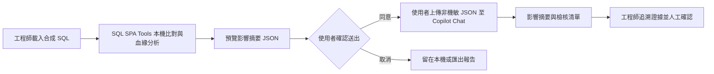

# SQL 變更影響評估 Copilot：黑客松參賽設計

## 設計目的

將 SQL SPA Tools 包裝為銀行資料與開發團隊可展示的 M365 Copilot 黑客松原型。作品聚焦在 SQL 變更前的影響評估：由 SQL SPA Tools 在瀏覽器本機分析 SQL 差異與欄位血緣，再由 Microsoft 365 Copilot 將結構化結果整理為影響摘要、待確認事項及人工檢核清單。

本文件是參賽原型的產品與技術設計，不代表銀行已核准正式環境部署，也不將 AI 產生的內容視為變更核准或正確性保證。

## 背景與現況

專案目前是多頁面的純前端工具集，包含 Oracle SQL Compare、SQL 欄位血緣分析器、資料品質稽核中心、SQL Catalog、Schema Studio 與 SQL Lab 等功能。SQL 比對與欄位血緣分析可作為原型的核心分析能力；專案整體採本機瀏覽器處理，且以離線使用為設計目標。

目前沒有專案 API 或 M365 Copilot 整合層。SQL Lab 在部分使用情境可嘗試從 CDN 載入 SQLite 引擎，因此原型的主要流程不依賴 SQL Lab，也不把網路載入作為 SQL 影響分析的前提。

## 使用者與問題

目標使用者是維護銀行資料流程、報表與 SQL 腳本的工程師、資料分析人員及變更審查者。SQL 欄位或來源表變更時，團隊需要找出可能受影響的 SQL、欄位及下游報表，再整理測試與上線前檢核事項。這項工作涉及多份腳本和人工追查，結果也不容易用一致格式交接。

原型要展示的價值是：以可追溯的 SQL 分析結果作為依據，讓 Copilot 協助整理資訊和準備檢核，不取代工程師的技術判斷與正式變更流程。

## 設計原則

1. 參賽環境允許上傳資料，但上傳內容不得含有機敏資料；送出前須確認資料已檢查並排除帳號、身分證字號等個人或金融識別資訊。
2. 原始 SQL 預設留在使用者瀏覽器本機；Copilot 只接收完成分析所需的最少結構化中繼資料。
3. 參賽 Demo 使用合成 SQL 與合成物件名稱，不使用真實客戶資料或銀行生產資料。
4. Copilot 的結論須連結回分析結果中的來源物件、目標欄位與分析訊息；無法由資料證明的內容要標為待確認。
5. Copilot 不執行 SQL、不修改原始檔、不批准變更，也不直接觸發部署或資料庫操作。
6. 正式環境資料處理、連接器、租用戶設定與發布方式須由銀行政策及 M365 管理者核准。

## 建議方案

依目前已確認的租用戶能力，原型以 Microsoft 365 Copilot Chat 的檔案上傳作為主要整合方式：SQL SPA Tools 產生經使用者檢查的非機敏 JSON 摘要，使用者將檔案上傳到 Copilot Chat，再以固定提示要求整理影響摘要、證據與檢核清單。此路線不依賴 Copilot Studio、declarative agent、連接器或 API 動作的授權。

Copilot Studio Agent 與連接器／API 動作目前因無授權而不列入黑客松 MVP。使用者已確認 Agent 可自行發布，不需管理者核准；若日後取得相關授權，此條件可支援後續擴充，但不改變目前 MVP 採 Copilot Chat 手動上傳的決策。

### 主要資料流程



### 分析摘要資料契約

送入 Copilot 的資料應限於完成影響說明所需的欄位，建議使用版本化 JSON 契約：

```json
{
  "schemaVersion": "1.0",
  "analysisId": "demo-change-001",
  "changeSummary": "操作者輸入之變更背景（本工具未驗證 SQL 版本差異）",
  "source": "SQL SPA Tools column lineage",
  "changes": [
    {
      "object": "DEMO_CUSTOMER",
      "column": "CUSTOMER_SEGMENT",
      "changeType": "definition_changed",
      "before": "VARCHAR2(20)",
      "after": "VARCHAR2(40)",
      "origin": "operator_entered",
      "verification": "not_verified_by_tool"
    }
  ],
  "impacts": [
    {
      "object": "DEMO_MONTHLY_REPORT",
      "column": "SEGMENT_LABEL",
      "relationship": "downstream",
      "evidence": "DEMO_CUSTOMER.CUSTOMER_SEGMENT -> DEMO_MONTHLY_REPORT.SEGMENT_LABEL"
    }
  ],
  "analysisMessages": [],
  "limitations": ["此結果依目前載入的 SQL 靜態分析；未載入的程序與報表不在範圍內。", "impacts 僅列出來源欄位符合操作者輸入 changes 的關係；其他欄位關係不在此清單。"]
}
```

允許上傳非機敏資料，但契約與上傳檔案都不得包含原始 SQL 片段、實際客戶識別資料、帳號、身分證字號、密碼、連線字串、其他個人資料或未經批准的內部路徑。送出前應檢查上傳內容；若發現上述資料或無法確認資料是否機敏，應提示使用者先移除或遮罩，並在確認完成前拒絕送出。若使用者提供了超出契約的欄位，原型應在送出前提示並移除或拒絕處理。

## 使用者體驗與 Copilot Chat 提示

### SQL SPA Tools

- 使用者在 Oracle SQL Compare 比較變更前後 SQL，並在 SQL 欄位血緣分析器分析來源、目標欄位與上下游關係。
- 使用者根據 SQL Compare 結果輸入變更物件、欄位及前後型別。欄位血緣頁不會自行驗證 SQL 差異；匯出 JSON 將這些資訊標記為操作者輸入，並要求使用者再次確認已人工核對。使用者查看完整摘要預覽，再確認資料名稱可提供後下載；不自動傳送。
- 原型產生 JSON 摘要及可供工程師查閱的本機分析報告。
- 若分析不完整或包含解析警告，摘要需保留警告與限制，不能將缺失關係呈現為「沒有影響」。

### Microsoft 365 Copilot Chat

使用者上傳 JSON 後，貼上專用提示，要求 Copilot 根據檔案內容以繁體中文回覆：

目前合成案例的固定提示見[Copilot Chat 固定提示](Copilot Chat 固定提示.md)；實際回覆仍須在 M365 Copilot Chat 演練並依驗證計畫評分。

1. 變更摘要及明確列出的受影響物件與欄位。
2. 每項影響的分析證據或來源關係。
3. 需由工程師確認的假設、缺漏與解析警告。
4. 建議的測試、報表核對及變更審查檢核項目。
5. 清楚說明靜態 SQL 分析的涵蓋範圍，不把推論描述成已驗證事實。

提示須要求 Copilot 不得虛構未出現在輸入中的資料表、欄位或相依關係。若輸入缺少影響資料或含有解析限制，應指出證據不足並要求人工檢查。輸出只供工程師審閱，不觸發任何資料庫或部署動作。

## 原型範圍

### 必須完成

- 一組可重複展示的合成 SQL 變更案例，包含至少一個上游欄位及兩個下游使用情境。
- 利用現有 SQL Compare 與欄位血緣分析器完成變更差異和影響關係分析。
- 一份有明確 `schemaVersion` 的最小影響摘要 JSON，並在傳送前供使用者預覽。
- 一份可重複使用的 Copilot Chat 提示，依據上傳的 JSON 產生繁體中文影響說明和檢核清單。
- 以 Copilot Chat 檔案上傳完成資料交接；檔案上傳前由使用者確認內容不含機敏資料。
- 至少一個涵蓋解析警告或資料不足的案例，展示 Copilot 如何表達不確定性。
- 一段 3 至 5 分鐘的 Demo 流程與簡報，說明資料邊界、人工覆核及效益衡量方式。

### 不包含

- 將含有帳號、身分證字號等機敏資訊的資料，或未經核准的銀行機密上傳至 Copilot Chat，或放入提示、測試資料及知識來源。
- 自動連線銀行資料庫、執行 SQL、修改 SQL 檔、建立部署或核准變更。
- 將現有所有工具逐一改造成 Copilot 工具。
- 建立完整企業級權限平台、審計系統或正式營運服務。
- 宣稱靜態解析能涵蓋所有動態 SQL、排程、程式碼生成或外部報表依賴。

## 可靠性、安全與失敗處理

- **使用者確認：** 送出前顯示目的地、資料欄位與提示；使用者可以取消。
- **允許上傳的資料：** 可上傳已確認不含機敏資料的資料；帳號、身分證字號等敏感識別資訊必須先移除或遮罩。無法確認時不得送出。
- **資料最小化：** 只送 schema 契約允許的結構化摘要；不傳原始 SQL。
- **輸入檢查：** 使用者上傳前確認 JSON 契約版本、必要欄位、檔案內容及合理大小；發現不支援欄位或機敏資料時先修正，不上傳。
- **證據保留：** 每項影響列出關係路徑或來源欄位；分析警告和限制隨結果一併傳遞。
- **無結果不等於無影響：** 沒有解析到下游關係時，Copilot 必須說明分析範圍與限制，不能保證沒有影響。
- **上傳或 Copilot 使用失敗：** 保留本機分析結果，提供 JSON／HTML 匯出；不因檔案上傳或 Copilot Chat 無法使用而遺失工作。
- **人工作業責任：** AI 回覆不視為審查核准、測試完成或部署許可。
- **租用戶治理：** 依銀行核准的環境、DLP、連接器政策、身分驗證、分享範圍、保存與稽核設定進行；不得以個人帳號或未核准環境承載銀行資料。

## Demo 驗收與效益衡量

評估使用同一個合成變更案例進行人工基準與原型展示，記錄：

目前固定案例為 [`copilot-impact-demo`](../sql-spa-tools-main/uat-fixtures/copilot-impact-demo/expected.json)；量測起訖、步驟字典、計算方式與空白試次表見[成效驗證計畫與紀錄](成效驗證計畫與紀錄.md)。尚未填入實測數據前，不報告節省率或實測準確率。

- 從載入 SQL 到整理出影響摘要所需時間與操作步驟。
- 預先定義的下游物件中，有多少被 SQL SPA Tools 找到並由 Copilot 正確列出。
- Copilot 回答中每項影響能否追溯到輸入證據。
- 面對缺漏或解析警告時，Copilot 是否明確表達限制，而非給出確定性過高的結論。
- 工程師審核檢核清單所需時間，以及是否能辨識出需要補充的測試或確認項目。

黑客松展示只報告實際測得的結果，不預先承諾節省百分比，也不以單一案例推論正式導入效益。

## 建議參賽評分表（100 分）

題目可自行設定，建議以「用 M365 Copilot 加速 SQL 變更影響評估，並保留銀行資料安全與人工覆核」為主題。以下為參賽團隊建議的評分規準，不代表主辦單位官方評分表；將成效驗證設為總分的一半，讓作品以可重現的證據說明價值。

| 評分項目 | 配分 | 評分重點 |
| --- | ---: | --- |
| 成效驗證 | 50 | 是否以明確基準、可重現案例與量測結果證明工作流程改善，細項見下表。 |
| 銀行資料安全與負責任 AI | 15 | 是否排除帳號、身分證字號等機敏資料；上傳前是否檢查並由使用者確認；Copilot 是否提供證據、限制及人工覆核提醒。 |
| 業務問題與場景適配 | 10 | 是否解決銀行 SQL 變更影響分析的實際痛點，使用者及流程是否清楚。 |
| M365 Copilot 工作流程 | 10 | 是否以現有 Copilot Chat 檔案上傳與提示流程完成端到端展示；交接步驟是否清楚且可重複。 |
| 技術可行性與可靠性 | 5 | 是否善用既有 SQL 比對與欄位血緣功能，並妥善呈現解析警告、缺漏與無結果情境。 |
| Demo 與溝通 | 5 | 是否在限定時間內清楚展示問題、操作、證據與結果。 |
| 創新與延伸性 | 5 | 是否提出適合銀行、可逐步延伸至其他 SQL 審查或資料流程的做法。 |
| **合計** | **100** | |

成效驗證的 50 分可再拆分如下：

| 成效子項目 | 配分 | 建議量測方式 |
| --- | ---: | --- |
| 完成時間與操作步驟 | 15 | 同一案例比較人工流程與原型流程的耗時及必要步驟，保留起訖定義與紀錄。 |
| 影響清單完整度與正確性 | 15 | 事先定義預期下游物件，以命中率、漏列及誤列數量評估。 |
| Copilot 回覆的證據一致性 | 10 | 檢查每項影響是否能回到 JSON 證據，並記錄無根據推論或錯誤摘要。 |
| 不確定性與重現性 | 10 | 使用缺資料、解析警告等案例，確認 Copilot 會揭露限制；重複演練並比較輸出是否穩定。 |

建議將「不得上傳含帳號、身分證字號等機敏資料」列為參賽安全門檻；違反時應依主辦單位及銀行正式政策處理，不以其他項目高分抵銷。評分時只採用實際量測結果，不預設節省比例或以單一案例宣稱全面效益。

## 參賽準備階段

1. **確認競賽條件：** 取得題目、評分標準、提交形式、Demo 時限、可使用的 M365 租用戶與工具清單。
2. **確認租用戶能力：** 目前沒有 Copilot Studio 額度，也沒有 declarative agent、連接器或 API 動作授權；已確認可自行發布 Agent，無須管理者核准。MVP 採 Copilot Chat 檔案上傳。
3. **凍結 Demo 案例：** 建立合成 SQL、預期血緣圖、預期受影響物件與解析警告案例，形成可重現驗收基準。
4. **實作最小資料交接：** 在現有分析結果上輸出版本化 JSON，確認使用者可以將檢查後的非機敏檔案上傳到 Copilot Chat。
5. **設計 Copilot Chat 提示與輸出：** 加入繁體中文格式、引用證據、限制說明、拒絕虛構及人工作業要求。
6. **演練與記錄：** 依 Demo 腳本實測成功、缺資料、解析警告、檔案無法上傳或 Copilot 無法讀取檔案等情境，記錄時間與結果。
7. **完成提案素材：** 準備問題、使用者、工作流程、資料安全邊界、量測結果、限制與後續導入條件。

## 尚待確認的外部條件

- **已確認：** 黑客松題目可自訂；本設計建議採「用 M365 Copilot 加速 SQL 變更影響評估，並保留銀行資料安全與人工覆核」。官方評分表尚未提供，文件內的 100 分評分表為參賽團隊建議版本，成效驗證占 50 分。
- **已確認：** 沒有 Copilot Studio 額度；沒有 declarative agent、連接器或 API 動作的授權；Agent 可自行發布，不需管理者核准。
- **已確認：** 可以上傳資料，但不得包含機敏資料，包含帳號、身分證字號等。MVP 以合成資料示範，上傳前須由使用者檢查並移除或遮罩機敏內容。
- **仍待確認：** 銀行對機敏資料的完整分類清單與上傳前檢查流程；若無法確認資料是否機敏，原型不得上傳該資料。
- **後續擴充條件：** 若未來取得 Copilot Studio／連接器授權，可評估 declarative agent 與 API 動作；目前不列入參賽 MVP。

## 官方技術參考

- [Ways to extend Microsoft 365 Copilot](https://learn.microsoft.com/microsoft-365/copilot/extensibility/overview)
- [Microsoft 365 Copilot Extensibility FAQ](https://learn.microsoft.com/en-us/microsoft-365/copilot/extensibility/faq)
- [Publish agents for Microsoft 365 Copilot](https://learn.microsoft.com/en-us/microsoft-365/copilot/extensibility/publish)
- [Data, Privacy, and Security for Microsoft Copilot](https://learn.microsoft.com/en-us/deployoffice/privacy/microsoft-365-copilot)
- [Enterprise data protection in Microsoft Copilot and Microsoft Copilot Chat](https://learn.microsoft.com/en-us/microsoft-365/copilot/enterprise-data-protection)

## 設計自我檢查

- 範圍集中於單一使用情境：SQL 欄位／來源變更的影響評估與檢核準備。
- 原型路線、備援資料交接、輸入契約、安全界線及失敗處理均已明確描述。
- 尚未確認的競賽條件與租用戶能力已標示為假設／前置條件，沒有寫成既定事實。
- 本設計未要求改變現有工具的資料處理行為；任何新增頁面或樣式仍須遵循根目錄 `AGENTS.md` 與 `docs/NAMING.md`、`docs/THEME.md`、`docs/FONTS.md`。
